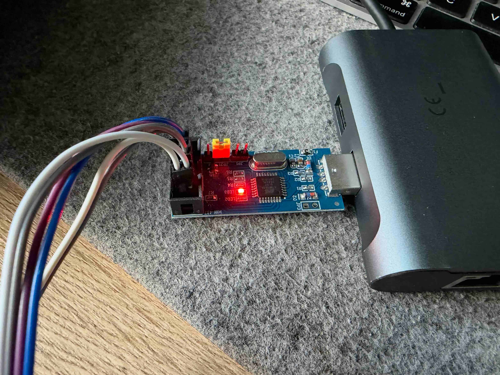
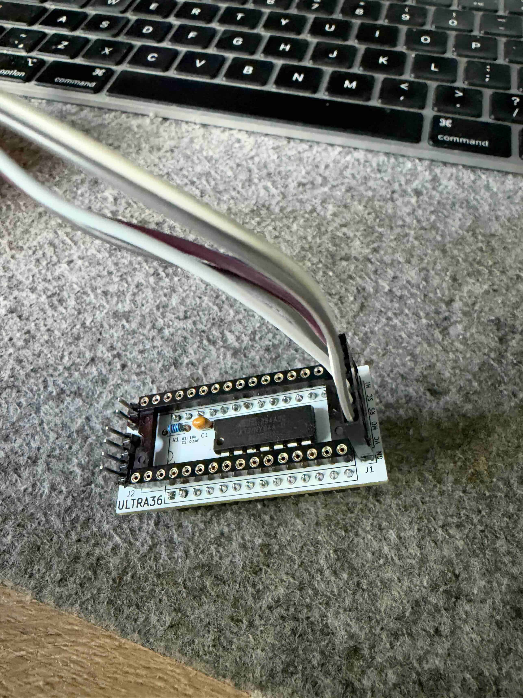

# Ultra-36 firmware update guide

This guide explains how to update the ATtiny84A microcontroller on an Ultra-36 ROM selector using a USBasp ISP programmer.

This procedure updates the ATtiny84A firmware. The menu and ROM bank images stored on the SST39SF020A/SST39SF040 flash chip are programmed separately.

## What you need

- An Ultra-36 board with an ATtiny84A.
- A USBasp ISP programmer and six connecting wires.
- A computer running macOS, Linux, or Windows with `avrdude` installed.
- The `bootloader.bin` file downloaded from the Ultra-36 firmware page on the LukasSoft website.

Despite its filename, `bootloader.bin` contains the complete Ultra-36 microcontroller firmware. No Arduino IDE or compilation is required to flash this file.

## 1. Prepare the board

1. Turn off the Commodore 128 and disconnect its power supply.
2. Note the Ultra-36 board's orientation and wiring before disconnecting anything.
3. Remove the Ultra-36 board from the U36 socket for programming, as shown below. Disconnect its other connections to the C128 so the programmer cannot feed power into the computer.
4. Connect the programmer with its USB cable unplugged. Configure its target supply for the board's 5 V supply, following your programmer's markings or documentation. Use only one power source during programming.
5. Remove flash or flash power jumper on Ultra36 board.



*USBasp programmer used for the update. Jumper positions vary between programmer models; check your own board's labels.*

## 2. Connect the ISP signals

Connect the six USBasp signals to the matching signals on the Ultra-36 programming header. The ATtiny84A pin numbers below refer to the DIP-14 chip, not the programmer connector.
NOTE. There are markings on Ultra36 board near programming header.

| USBasp signal | ATtiny84A signal | ATtiny84A DIP pin |
| --- | --- | --- |
| MOSI | PA6 / MOSI | 7 |
| MISO | PA5 / MISO | 8 |
| SCK | PA4 / SCK | 9 |
| RESET | PB3 / RESET | 4 |
| VCC | VCC | 1 |
| GND | GND | 14 |



*Ultra-36 board with the programming wires attached to its header.*

Check each signal against the board and programmer labels. Do not rely on wire colours or assume that every USBasp connector has the same orientation. After checking the connections, plug the USBasp into your computer.

## 3. Install the programming software

### macOS

With Homebrew installed, open Terminal and run:

```sh
brew install avrdude
```

### Linux

On Debian, Ubuntu, or Linux Mint, open a terminal and run:

```sh
sudo apt update
sudo apt install avrdude
```

On other distributions, install `avrdude` with your distribution's package manager.

If `avrdude` reports a USB permission error, configure a USBasp udev rule for your distribution and reconnect the programmer. Alternatively, run the programming command with `sudo`.

### Windows

Install `avrdude` using an AVR toolchain package, Arduino IDE/CLI, Scoop, or Chocolatey. Make sure `avrdude.exe` is available in your terminal's PATH, or use its full path when running the commands below.

Install the USBasp driver with Zadig if needed. Select the USBasp device carefully; `libusbK` or `WinUSB` normally works. Do not replace the driver for another USB device.

## 4. Update an existing Ultra-36 chip

Download `bootloader.bin` from the LukasSoft Ultra-36 firmware page and open a terminal (macOS/Linux) or PowerShell (Windows) in the folder containing that file.

**Firmware updates do not require fuse writes.** For a chip already programmed for Ultra-36, run this flash-only command on any of the three platforms:

```sh
avrdude -c usbasp -p t84 -U flash:w:bootloader.bin:r
```

The final `:r` tells `avrdude` that the file is a raw binary. Keep it in the command.

Wait until writing and verification finish successfully before disconnecting anything. Do not interrupt power during programming, and do not disable verification.

Leave the existing fuse settings unchanged when updating. The fresh-chip instructions below are only for initial setup of a new ATtiny84A. The expected high fuse, `0xD7`, enables EEPROM preservation during chip erase, allowing saved bank and JiffyDOS settings to survive an update. If the chip's configuration is unknown, do not assume those settings will be preserved.

### SCK warning on inexpensive USBasp clones

Some inexpensive USBasp clones, including many Chinese-made programmers, use older firmware and may display:

```text
avrdude: warning: cannot set sck period. please check for usbasp firmware update.
```

**You can ignore this warning if flash writing and verification both complete successfully.** It means the programmer cannot set the ISP clock speed requested by `avrdude`; it does not by itself mean the Ultra-36 update failed. The firmware update mentioned in the message refers to the USBasp programmer. See the [AVRDUDE USBasp implementation](https://github.com/avrdudes/avrdude/blob/main/src/usbasp.c).

If programming fails as well, troubleshoot that failure. On older USBasp firmware, `-B 10` may have no effect; use the programmer's slow-SCK jumper if available, following its documentation.

## Programming a fresh ATtiny84A

Use this section for a new chip that has not yet been configured for Ultra-36.

| Setting | Value |
| --- | --- |
| Target MCU | ATtiny84A (`t84` in avrdude) |
| Clock | Internal 8 MHz oscillator, full speed |
| Low fuse | `0xE2` |
| High fuse | `0xD7` |
| Extended fuse | `0xFF` |
| Lock byte | `0xFF` |

The low fuse `0xE2` selects the internal 8 MHz oscillator and disables the divide-by-8 clock prescaler. Use these values only for the specified ATtiny84A target.

### macOS / Linux — Terminal

```sh
avrdude -c usbasp -p t84 \
  -U lfuse:w:0xE2:m \
  -U hfuse:w:0xD7:m \
  -U efuse:w:0xFF:m \
  -U lock:w:0xFF:m \
  -U flash:w:bootloader.bin:r
```

### Windows — PowerShell

```powershell
avrdude -c usbasp -p t84 `
  -U lfuse:w:0xE2:m `
  -U hfuse:w:0xD7:m `
  -U efuse:w:0xFF:m `
  -U lock:w:0xFF:m `
  -U flash:w:bootloader.bin:r
```

PowerShell uses a backtick for line continuation. Keep it as the last character on each continued line, without trailing spaces.

## 5. Reinstall and check operation

1. After successful verification, unplug the USBasp from USB and remove all programming wires.
2. Reinstall the Ultra-36 board in the U36 socket in its original orientation. Reconnect its normal wiring.
3. Power on every connected IEC device, or disconnect devices that are switched off, before powering on the C128.
4. Start the C128. Hold RESET for approximately three seconds, then release it to return temporarily to the Ultra-36 menu.
5. Select a ROM bank in the menu, then reset the C128 and check that the selected bank starts. If you use JiffyDOS switching, check that selection as well.

The long RESET selects menu bank 0 temporarily without changing the saved bank selection. A normal reset loads the saved bank and JiffyDOS state.

## Troubleshooting

| Problem | What to check |
| --- | --- |
| `avrdude` is not found | Check the installation and PATH. On Windows, you can run `avrdude.exe` using its full path. |
| USBasp is not detected | Check the USB connection and, on Windows, the USBasp driver. |
| USB permission denied on Linux | Configure a USBasp udev rule and reconnect, or run the programming command with `sudo`. |
| `cannot set sck period` warning | Common on inexpensive USBasp clones with older firmware. Ignore it if writing and verification succeed; otherwise check the slow-SCK jumper and connections. |
| Target does not answer or initialization fails | Unplug USB, check all six ISP connections and target power, then reconnect. Try the slower ISP command below. |
| Device signature does not match | Check that the target is an ATtiny84A and the command uses `-p t84`. Do not bypass the signature check with `-F`. |
| `bootloader.bin` cannot be opened | Open the terminal in the download folder, or supply the full file path. |
| Verification fails | Check wiring and power, try a slower ISP clock, and program again. Do not treat the update as complete until verification succeeds. |
| C128 freezes or misses Ultra-36 acknowledgements | Check board orientation and normal wiring. Power on connected IEC devices or disconnect those that are off; unpowered devices can load or back-power the bus. |

For a factory-fresh chip or clock/synchronization errors, try a slower ISP clock:

```sh
avrdude -c usbasp -B 10 -p t84 -U flash:w:bootloader.bin:r
```

If the chip still needs its fuses configured, add `-B 10` to the appropriate fresh-chip command above so that both the fuse writes and firmware programming use the slower clock.
